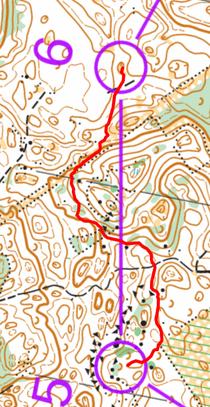

## Suppamaasto

Viime kertta oli Lahti-Hollola Jukolan viesti. Muistan vielä noi tosi hienot isoa suppaa mihin kiersin niin hienost
viestissä.

Ja tuli ihan sama mieltä tämä kerttaa. Se oli kuin Nuuksio vastapäin. Jos Nuuksiossa kierttää avokalliomäkeä ympäri,
tällää kierttää syviä kuoppia ympäri :)

38/63

- K-1: Ha, heti juoksin se ohi mutta huomasin nopeasti. No. Siellä oli valkoinen ja vaalea-vihreä metsä. Mutta eikä
  ollut kuvioraja, eli epäselvä. Kyllä oli epäselvä.
- 1-2: `30/58`. Niin kiva :) Tasaisen maasto. Juoksiin liikaa polkuu mutta huomasin ja känsin ja se meni ihan kivasti.
- 2-3: piiitkä. Halusin kiertää ympäri noi syvä kuoppaa. No kersin mutta ehkä olisi nopeampi mennä suorempi ja lukea
  karttaa tarkempi. Mutta, mietin metsässä että okay. Tämä on jukolan viesti viimeinen harjoitus. Viesti aikoina on
  yöllä, ja sillion minun straategia on kiertää ja ota varmempi rastinotto. Niin tein eli ihan okay. No. Rastinotto ei
  mennyt kuin Strömsössä juoksin se ohi, käänsin ympäri ja näin rasti. Kyllä oli vaikea huomoida missä oikeasti olin ja
  käytä kompassilla suunntaa.
- 3-4: `22/58`. Tosi kiva. Polku. Juoksu vaalea vihreän asti. Näin kumpare. Otin suuntaa. Näin suppia vasemmalle ja
  oikealle.
- 4-5: Otin myös täällä varmempi. Enkä halunut mennä syvämpi tosi vaikea näköinen suppamaastolle.
- 5-6: `26/58` Vaikea. Juoksin keltaiseen alueen kulmalle, kivirasalle, tosi syvä kuoppa ympäri. Tuli silloin epäselvä
  tunne kun pitäisi lähteä tosi jyrkkä aluelle ylöspäin mutta näin missä olin. Tosi kiva fiilis kun menin suoraan
  suppaan ja se oli minun! Hyvä tulos silti :)
- 6-7: Kova. Juoksin paljon. Vauhti oli 11:30min / km. Niin iso kierros. Se lisätty noin 400m vertaillut lyhyin
  reittinvalinta. Mutta sain se rasti varmasti. Voisin kertänyt aikasempi ja mennä metsän kautta ja ei alas tielle ja
  ylös taas rastille.
- 7-8: Hmm.. No juoksin polku. Kartassa risteyssä oli mitä luulin oli iso kivi. Kun saapuin polkuristeyksessä ja en
  nähnyt sitä tuli epävarma tilanne. Katsoin tartkempi ja se oli ympyrä missä oli piste, eli en tiedä joku pieni
  kivitorni vai hautta vai jotain.
- 8-M: :D 4:34min/km vauhti viimestä 146m

[{:height=400}](images/rahametsa.5-6.png)

[Tulokset](https://irma.suunnistusliitto.fi/public/event/view/22769#results) ja
[Livelox](https://www.livelox.com/Viewer/Sunnuntairastit/B?classId=1197402&live=false&tab=legView&leg=2)
