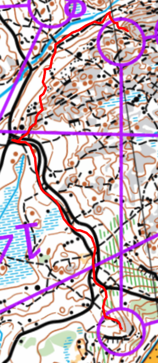

## Melkoi tutto maasto

Olin eii niin kauhan sitten täällä, paitsi silloin alku oli toiselta puolelta (IKEA:lta).

## Rastia

37/67

- K-1: Ha, heti tuli epävarmuus. Halusin ota varmempi. Toisalta kun lähestyin tuli epävarma minkälainen iso kuoppa se
  oli, ja kun tulin lähempi näin että se oli tämä ja se oli tuttu kuoppa.
- 1-2: Ihan hyvä. Se oli juoksu takaisin mistä tulltiin ja tiesin jo mikä iso kivi se oli ja että halusin sen jälkeen
  löytää polku mäelle.
- 2-3: Tosi kiva rauniot!
- 3-4: Näin polku ja halusin ota avokallio rastiin. Ehkä juoksin hieman liika mäen päällä mutta löysin varmast.
- 4-5: Ehkäpä paras väli. Iso tie. Polku suon kautta, en otannut polku mäen yli ja näin se metsä avokallion vieressä -
  halusin ota myös täällä avokallio kuin tie rastille.
- 5-6: Myös toteutti hyvin. Aika paha alamäki.
- 6-7: Epävarma. Luulin että voisin juostaa enemmän ylämäelle.
- 7-8: Nooo. Aika hyvä mutta juoksin rastin ohi suora 9:lle ja en usko että leimasin :/ Myös epävarma. Minulla oli hyvä
  suunnitelma. Vaihdoin keskellä koska en halunut juostaa siellä, siellä oli palja kaatuneita puita. Mietin sitä aika
  paljon ja harmitti. En keskittynyt seuraava rastia!
- 8-9: :D .D
- 9-10: Tuttu masto, tiesin mikä metsä se iso kivi oli. Totta kai luulin että rasti olli isokiven vieressä ja kun näin
  että eikä ole tarvitsen pysähtyä ja tarkistaa missä se rasti oli..
- 10-11: ehhhh 90 astettä väärää suuntaa. En tienyt mikä oja hyppäsin yli. Juoksin liian pitkä. Totta kai siellä oli
  jonkin kiintorasti.
- 13-14: Luulin että oli lähempi rasti. Enkä ollut. Toistalta tulin hyvin rastille, se oli aika hyvin piilotettu.
- 14-15: Juoskin joku perässä ja se autoi aika paljon. Tarkistin vaan että olin oikea reitille. Kiva suo ei niin märkä.
- 15-16: En halunut juostaa märkä suo kautta kuin muut oti vääh kiertto reitti.

[{:height=400}](images/kasavuori.7-8.png)

[Tulokset](https://esak.kapsi.fi/ER/2026/Kasavuori.html) ja
[Livelox](https://www.livelox.com/Viewer/Espoorastit-30-Kasavuori/B?classId=1306219&live=false&tab=player&selectedParticipantId=5260812)

## Lopuksi

Suunnistus kausi alkaa loppua. Haluan mennä vielä yösuunnistukseen muutama kertaa. Pitä suunnitella ne heti että se myös
toteuutuu!
